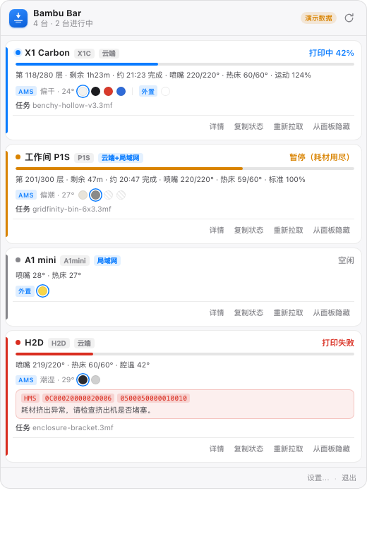

# Bambu Bar

**[中文](#bambu-bar) | [English](#english)**

拓竹（Bambu Lab）打印机的菜单栏 / 托盘监控面板，Tauri 2 实现，支持 macOS / Windows / Linux。

从 v1.0.4 起，本仓库的主线就是这份 Tauri 实现；Electron 的**平台层**（主进程、preload、旧的双页面前端）
留在 `v1.0.3` 标签与历史记录里。两者是**同源实现**：视图模型与状态机逻辑仍是原来那份经过真机校准的 JS
（就在本仓库 `src/` 下，打包进 WebView），换成 Rust 的只有传输层（MQTT、鉴权）与平台能力（托盘、窗口）。
所以两个版本的状态判断、耗材解析、完工时刻推算**一定一致**——不存在「新版把某台机认成失败」这种漂移。

---

## 实测数据

同一台机器（Apple Silicon）、同一份演示数据、都在空闲 12 秒后取样：

| 版本 | 常驻物理足迹 | 说明 |
| :--- | ---: | :--- |
| Electron 38（旧） | **257.5 MB** | 主进程 74.5 + GPU 107.0 + 网络 7.1 + 渲染 68.9 |
| Tauri 2（本版） | **72.9 MB** | 主进程 38.0 + WebContent 28.2 + Networking 6.7 |
| Tauri 2（面板打开、真实数据） | **约 78 MB** | 主进程 36.8 + WebContent 41.5 |

- 数据取自 `vmmap -summary` 的 `Physical footprint`，不是 `ps` 的 RSS（RSS 会把共享框架页重复计入）。
- 空闲 CPU 0.0%（1 秒节拍的托盘刷新 + MQTT 收包）。
- 真实账号实测：3 台设备（2 台打印中）轮播正常，云端 MQTT 首帧在启动后 2 秒内到达。
- 单文件可执行 11.9 MB、`.app` 11 MB、`.dmg` 3.3 MB；Electron 版 DMG 约 90 MB。
- 关掉 `--panel` 的窗口不进前台时，WebContent 那 28 MB 也不会被创建（窗口是懒显示的）。

---

## 跨平台：托盘能力是不对等的，这是 OS 限制

| 能力 | macOS | Windows | Linux |
| :--- | :--- | :--- | :--- |
| 托盘文字标题 | ✅ `NSStatusItem.setTitle` | ❌ 只有图标 + tooltip | ❌ 只有图标 + tooltip |
| 模板图标（跟随明暗反色） | ✅ | ❌ 需自备深浅两套 | ❌ 同左 |
| 悬浮面板定位 | ✅ 读托盘矩形 | ✅ | ⚠️ Wayland 下位置受限 |

所以 `tray.rs` 对外只暴露一个 `update(app, state)`，内部两条实现：

```
macOS     →  文字标题「 X1C 42%」（像素级定宽）+ 模板图标
Win/Linux →  32×32 动态位图（状态色进度环 + 中心点）+ tooltip
```

Windows / Linux 的图标是 Rust 侧用 `tiny-skia` 现画的（`render_badge`），不依赖任何图像库或运行时资源。


```
tray.rs 单测：
  advance_table_matches_appkit_sample  逐字累加 == AppKit 实测 62.68px（误差 <0.05px）
  entry_text_has_no_padding_of_its_own  entry_text 只产出干净文字（补白只在 pad_centered 里加）
  padding_is_split_evenly_...          左右补白差 ≤1px、总宽落在目标宽度 ±1px
  percent_slot_is_right_aligned        1% / 42% / 100% 的「%」严格对齐
  width_tracks_content_not_a_fixed_120 A1 这类短机型宽度上限 < 70px
  slot_width_is_constant_...           轮播集里每帧补到的总宽度一致
  no_state_mark_in_menu_bar            任何状态都不带 ‖ / … 前缀
  eta_crosses_midnight                 跨天完工带 +1 后缀
  lan::serial_is_found...              SSDP 回复里按 15 位特征找序列号
```

运行时验证（`BAMBU_BAR_DEBUG_TRAY=1`）：

```
[tray] idx=0 target=60.04 width=59.50 rect=Some((617.0, 0.0, 100.0, 30.0)) text="\u{200a}\u{200a}P1S  79%\u{200a}"
```

同一轮播集里 `target` 恒定 → 宽度不跳；补白左右各半 → 文字居中。
无障碍接口（`AXExtrasMenuBar`）读回：`title="  P1S  79% " size=(102, 24)`——没有 `‖`。
截图逐列取墨迹：图标 564.5…576.0pt、文字 585.0…639.5pt，`P`/`1`/`S`/`7`/`9`/`%` 六个字符各自成段。

---

## 两条通道：云端 + 局域网直连

| 通道 | 鉴权 | 依赖 | 适用 |
| :--- | :--- | :--- | :--- |
| 云端 MQTT | 登录令牌（uid + token） | 拓竹服务器、外网 | 出门在外、跨网查看 |
| 局域网直连 | 访问码（用户名固定 `bblp`） | 打印机 8883 端口 | 断外网、低延迟、不想登录 |

两条通道互相独立，同一台机器可以同时挂上：报文都是 `{"print": {...}}` 的增量 diff，
合并逻辑复用同一份 `mqtt::merge_payload`（深合并、取消标记、舱门 bit），谁先到用谁的。
单条通道断掉不会立刻把设备判成离线——`set_offline_if_stale` 要「确实 90 秒没报文」才转离线，
否则另一条通道可能一秒前刚送过数据。

局域网的三个实现要点：

1. **证书必须跳过校验**：打印机是自签证书、主机名还是它自己的 IP，校验链没有意义，
   真正的鉴权是 MQTT 的 `bblp` + 访问码。`lan.rs` 里手写了一个 rustls `ServerCertVerifier`，
   签名算法仍走 rustls 自己的实现（不手写密码学）。rumqttc 的 `Native` 后端做不到这件事，
   所以打开了 `use-rustls` 特性并直接注入 `ClientConfig`。
2. **添加前先试连**：`lan_probe` 只等 CONNACK，8 秒超时。访问码错、没开局域网模式、
   不在同一网段，三种情况分别给不同的中文提示——不通过就不写配置，
   免得菜单栏里多一台永远连不上的机器。
3. **SSDP 发现**：向 `239.255.255.250:1990` 发 M-SEARCH，回复里带机型/名称/序列号。
   不同固件的字段名不一致，序列号干脆不认字段名，直接按「15 位大写字母数字」特征找。

用法：打印机屏幕 → 设置 → 网络 → 局域网模式（打开后能看到访问码），
然后在设置窗「局域网直连」里点「扫描局域网」→ 选一台 → 填 8 位访问码 → 添加。

> 注意：开启局域网模式后，这台打印机的云端连接会被打印机自己断开（拓竹的设定）。
> 想两边都要，就在 Bambu Studio / 手机端保持云端登录，本应用两条通道都配上。

---

## 目录结构

```
bambu-bar/
├── src/                     ★ 纯逻辑核心（与 Electron 版同一份文件，被 esbuild 打进 WebView）
│   ├── core/                状态机、视图模型、AMS 取色、完成记忆、错误码查询
│   ├── config/              状态名/文案/本地化表
│   └── dev/demo-data.js     演示数据
├── test/                   node:test 单测（29 条）：报文 → 视图、错误码查表这一层不靠肉眼验证
│   ├── printer-view.test.js
│   └── error-codes.test.js
├── ui/                     前端 = Electron 版的 HTML/CSS/JS + 一层 Tauri 适配
│   ├── index.html          面板
│   ├── settings.html       设置窗（登录 / 设备 / 局域网直连 / 显示偏好）
│   ├── settings.js         设置窗逻辑：两种登录方式、二次验证、倒计时、局域网增删
│   ├── style.css           与 Electron 版逐字节相同
│   ├── popover.js          与 Electron 版逐字节相同（只认 window.bambu）
│   ├── shim.js             ★ window.bambu 的 Tauri 实现（IIFE 隔离）
│   ├── actions.js          面板按钮接线（刷新 / 设置 / 退出）
│   ├── core-entry.js       打包入口：把 src/ 的纯逻辑核心汇出为 window.BambuCore
│   └── core.bundle.js      esbuild 产物（npm run build:ui 生成，不入库）
└── src-tauri/
    ├── src/tray.rs         托盘展示层（定宽轮播 / 对称补白 / 动态图标 / ETA）
    ├── src/windows.rs      面板与设置窗的创建、贴托盘定位、失焦收起
    ├── src/mqtt.rs         云 MQTT：深合并、pushall、取消标记、舱门 bit
    ├── src/lan.rs          局域网直连：bblp + 访问码、自签证书、SSDP 发现、试连
    ├── src/auth.rs         拓竹云鉴权（登录 / 短信 / 设备列表 / uid）
    ├── src/error_codes.rs  官方 HMS 码表：本地 BambuStudio → GitHub，负缓存
    ├── src/state.rs        运行时状态 + TrayItem 粗分类
    ├── src/commands.rs     前端 IPC
    ├── src/config.rs       配置持久化（0600）
    └── src/demo.rs         演示数据（菜单栏侧）
```

### 为什么视图模型留在 JS

`resolveState` / `buildPrinterView` 里堆的是**真机校准出来的字段兼容逻辑**：新旧固件温度打包方式不同、
AMS 深合并后「空槽」和「没插料」是两种语义、双喷头取色、跨天 ETA、完成记忆。重写成 Rust 只会多出
一份可能漂移的实现。传输层才是需要换语言的部分（Electron 的网络栈换成了 rustls + rumqttc）。

这些 JS 现已随仓库一起维护，`npm test` 会先跑那 29 条 JS 单测、再跑 Rust 单测——视图逻辑改坏了在 CI 就红。

---

## 开发

```bash
npm install            # esbuild（打包 JS）+ @tauri-apps/cli
npm run build:ui       # 打包 ui/core.bundle.js（tauri build 前会自动跑）
npm run dev            # npx tauri dev
npm test               # 29 条 JS 单测 + 17 条 Rust 单测
```

调试开关：

```bash
BAMBU_BAR_DEBUG_TRAY=1 ./target/release/bambu-bar   # 打印托盘每次写入的标题与像素宽度
./target/release/bambu-bar --panel                  # 启动即弹出面板（截图/调试用）
```

演示模式：设置窗勾选「演示模式」，或直接改配置 `demo_mode: true`。
配置文件位置（与 Electron 版字段兼容，可直接拷过来）：

- macOS `~/Library/Application Support/com.bambubar.menubar/config.json`
- Windows `%APPDATA%\com.bambubar.menubar\config.json`
- Linux `~/.config/com.bambubar.menubar/config.json`

---

## 打包

```bash
npm run build        # 只出 .app（bundle.targets = ["app"]）
./scripts/make-dmg.sh  # 再压出 .dmg
```

### 两处与默认流程不同的地方

1. **不用 tauri 自带的 dmg 目标**。它的 `bundle_dmg.sh` 会通过 AppleScript 让 Finder 摆图标位置，
   在没有「自动化」授权、或 macOS 新版上这一步直接失败，而且会把**已经打好的 .app 一起判成打包失败**，
   报错只有一行 hdiutil 的废弃警告，极具误导性。`scripts/make-dmg.sh` 不碰 Finder：
   把 `.app` 和 `/Applications` 软链放进暂存目录，`hdiutil` 压成只读镜像，实测挂载/运行正常。
2. **release 用 thin LTO**（`lto = "thin"`、`codegen-units = 4`）。全量 LTO + `codegen-units = 1`
   的链接阶段要吃掉数 GB 内存、十几分钟，在内存受限的环境里会直接被 SIGKILL（exit 137）。
   thin LTO 的产物体积只多约 2.6 MB，但构建时间从 12 分 40 秒降到 5 分 52 秒，且可稳定复现。

| 平台 | 产物 | 依赖 |
| :--- | :--- | :--- |
| macOS | `.app` + `.dmg`（脚本生成） | 10.15+，Apple Silicon 与 Intel 均可 |
| Windows | `.msi` / `.exe` | WebView2（Win10 1803+ 与 Win11 自带） |
| Linux | `.AppImage` / `.deb` | `libwebkit2gtk-4.1`、`libayatana-appindicator3` |

Linux 两条注意事项：

1. **Wayland** 下全局窗口定位不可用，面板靠托盘矩形定位；GNOME 需要装 AppIndicator 扩展才看得到图标。
2. `.deb` 的 `depends` 已在 `tauri.conf.json` 里声明，`.AppImage` 打包机需要装 `libfuse2`。

---

## CI

`.github/workflows/build.yml` 在 **Actions** 页手动触发，或推 `v*` 标签时自动跑。
四个矩阵并行：

| Job | Runner | 产物 |
| :--- | :--- | :--- |
| macos-arm64 | macos-14 | `.app` + `.dmg`（`aarch64-apple-darwin`） |
| macos-x64 | macos-14 | `.app` + `.dmg`（`x86_64-apple-darwin`，交叉编译） |
| windows | windows-latest | `.exe`（NSIS） |
| linux | ubuntu-22.04 | `.AppImage` + `.deb` |

打包前会先跑 **29 条 JS 单测 + 17 条 Rust 单测**，两套都绿了才出包。
Linux job 额外装 WebKitGTK 与 AppIndicator——缺这两个库能编过，但运行起来既没图标也没界面。

<details>
<summary>踩过的坑（改 CI 前先看一眼）</summary>

- **Node 版本**：`node --test "test/*.test.js"` 这种带引号的 glob 写法，Node 20 不认
  （会当成字面路径去找，报 `Could not find '.../test/*.test.js'`），Node 22 才原生支持。
  CI 里必须用 Node 22。
- **`macos-13` runner 已下线**，x64 改到 macos-14 交叉编译。因为两个 macOS job 都是 arm64 主机，
  Rust target 由 matrix 显式给出（`matrix.rust`），不再按 `matrix.os` 猜。
- **`tauri-action` 调的是 `npm run tauri build -- <args>`**，所以 `package.json` 里必须有
  `"tauri": "tauri"` 这个脚本，否则报 `Missing script: "tauri"`。
- **Windows 需要 `icons/icon.ico`**。仓库里原本只有 macOS 用的 png + icns，
  现在用 `npx tauri icon` 从 1024×1024 源图生成了全套（android/ios 目录用不到，已删）。
  注意 `tauri icon` 会把源 `icon.png` 改写成 512×512，macOS 图标清晰度会掉——
  源图和 `icon.icns` 单独还原回原样，只提交新增的变体。
- **bash 在 UTF-8 locale 下会把变量名后面的中文标点算进变量名**：
  `echo "找不到 $APP，先跑"` 里的中文逗号会被当成变量名的一部分，
  报 `APP?: unbound variable`。本机 locale 不是 UTF-8 时怎么跑都正常，只有 CI 炸。
  shell 脚本里变量后紧跟非 ASCII 标点，一律写 `${APP}`。

</details>

---

## 与 Electron 版的取舍

设置窗的登录是重新设计的：先选「服务器区域」和「登录方式」，再填**一张表**。
早期版本把「登录」「发送短信验证码」「刷新设备」并排放在一行、验证码行还要点出来，
用户不知道先点哪个——这是被明确反馈过的问题。
现在邮箱二次验证会直接接管这张表（收起密码登录按钮、锁住账号与区域、只剩「完成登录」和「换个账号重新登录」），
登录成功后提示「已同步 N 台打印机」——因为两条验证码路径都会在登录后立刻拉设备清单，
不会再出现「提示登录成功但设备列表空着、要手动点刷新」。

保留：面板视觉、状态语义、AMS 图谱、轮播节奏、配置格式。
放弃：系统钥匙串（Electron 用 `safeStorage`，这里 token 以 0600 权限明文存盘——跨平台钥匙串要三套后端，
留到后续版本）。

### 已知差异（还没补上的）

登录后的 HMS 错误码表这一层 1.0.5 补上了（见下面「官方 HMS 错误码表」一节），
Electron 版与 Tauri 版现在的失败说明行为一致。

剩下的差异只有一条：**系统钥匙串**。Electron 版用系统的 `safeStorage` 存拓竹云令牌，
这里以 0600 权限明文存盘——跨平台钥匙串要三套后端，留到后续版本。

---

## 官方 HMS 错误码表

打印机报失败时只给一个数字码（`HMS 0C0002...`）和一个 `fail_reason`，
光看数字没人知道发生了什么。拓竹官方把这些码对应到一句中文说明，码表就放在
BambuStudio 的 `resources/hms/hms_<语言>_<机型代号>.json` 里。

有了它，面板上的失败卡片会多一行官方原文：



```
HMS  07008007
耗材挤出异常，请检查挤出机是否堵塞。      ← 这一行是查表得来的
```

### 机型代号 = 序列号前 3 位

`01P00C560200187` → `01P`（P1 系列）、`03919B610800044` → `039`（A1）。
码表文件名就是 `hms_zh-cn_01P.json` 这样。

### 取表顺序：先本地，后网络

| 顺序 | 来源 | 说明 |
| :--- | :--- | :--- |
| 1 | `~/Library/Application Support/BambuStudio/hms/` | BambuStudio 运行时从服务器拉的，**覆盖 GitHub 上没有的机型** |
| 2 | `/Applications/BambuStudio.app/Contents/Resources/hms/` | 安装包内置（7 个代号 × 16 种语言） |
| 3 | 自有缓存 `配置目录/error-codes/` | 从 GitHub 下过一次就存这儿 |
| 4 | GitHub `bambulab/BambuStudio` 仓库 | 只内置了 7 个代号（093 / 094 / 20P / 22E / 239 / 26A / 31B） |

**第 1 步是关键**：P1（`01P`）、A1（`039`）这些常用机型的表**不在 GitHub 上**，
只有装了 BambuStudio 才拿得到——BambuStudio 会为连过的每台机器下载对应机型的表。
没装 BambuStudio 的话，这些机型只能显示 HMS 码、没有中文说明。

表格：

| 表 | 索引 | 对应报文 |
| :--- | :--- | :--- |
| `device_error` | 8 位 hex | `fail_reason`（失败主因，如 0300400C = 任务已取消） |
| `device_hms` | 16 位 hex | `hms[].attr`（高 8 位）+ `hms[].code`（低 8 位） |

### 分工

Rust 只负责「把表弄到手」（找本地文件、下载、缓存），**不解析**；
解析与查表在 JS 侧（`src/core/bambu-error-codes.js`，从 Electron 版原样保留），
所以查表逻辑和 Electron 版是同一份文件，不是重写的。

拿不到表就返回 `None`，前端退化成「只显示 HMS 码」——**宁可少说一句，也不给错文案**。
国内网络访问 GitHub 慢的话，设 `HTTPS_PROXY` 环境变量即可（reqwest 会读）。

### 调试

```bash
BAMBU_BAR_DEBUG_TRAY=1 /Applications/Bambu\ Bar.app/Contents/MacOS/bambu-bar
# [error-codes] hms_zh-cn_01P.json ← /Users/fengke/Library/Application Support/BambuStudio/hms/hms_zh-cn_01P.json
# [error-codes] hms_zh-cn_094.json ← GitHub（已存进自有缓存）
# [error-codes] hms_zh-cn_00M.json ← GitHub 404（该机型没有官方表）
```

---

## 更新记录

### 1.0.5

- **接上官方 HMS 错误码表**：打印失败时，面板上的 HMS 码下面多一行官方中文说明
  （如「耗材挤出异常，请检查挤出机是否堵塞。」）。取表顺序：本地 BambuStudio 的缓存 →
  安装包内置 → GitHub 兜底。详见上面「官方 HMS 错误码表」。
- 演示模式的失败机器改用**码表里真实存在**的码：原来那几个是随手编的数，
  查不到文案，演示时永远看不到「失败原因」那一行——而那正是要演示的功能。

### 1.0.4

接在 `v1.0.3` 之后的版本：这一版把应用整体换成 Tauri 2（Electron 的平台层源码留在 `v1.0.3` 标签与历史里，
`src/` 下的纯逻辑核心随主线继续维护）。

- **新增局域网直连**：`bblp` + 访问码直连 8883，不依赖拓竹服务器；带 SSDP 扫描、
  添加前试连、访问码错误的中文提示。云端与局域网可同时挂在一台机器上。
- **修复菜单栏状态不居中**：改为「左右对称补白」——先把轮播集里最宽那条的宽度定为目标，
  再把差额对半分到文字两侧。宽度依然恒定（轮播时右边的系统时钟不跳），文字落在条目正中。
  （中途试过 `NSStatusItem.setLength` 钉死宽度让 AppKit 自己居中，实测条目窗口会被挪出菜单栏，已回退，见上文。）
- 连接健康判定改为「90 秒无报文才判离线」，避免两条通道互相打断。
- 设置窗新增「局域网直连」卡片；窗口尺寸 580×840。
- 菜单栏去掉状态符号：暂停不再挂 `‖`、准备/换料不再挂 `…`，只留「机型 + 进度」。
- 仓库主线里的 JS 核心带上了原来的 19 条视图单测，`npm test` 会连同 Rust 单测一起跑。
- **接上 GitHub Actions**：四平台并行构建（macOS arm64/x64、Windows NSIS、Linux AppImage+deb），
  打包前先跑两套单测。release 里的三个安装包（macOS 双架构 DMG、Windows 安装包）都来自 CI 产物。

---

# English

**[中文](#bambu-bar) | [English](#english)**

A menu bar / system tray monitor for Bambu Lab 3D printers, written in Tauri 2, running on macOS, Windows and Linux.

Since v1.0.4 this repository's main branch *is* the Tauri implementation. The Electron **platform layer** (main process, preload, the old two-page front end) stays behind in the `v1.0.3` tag and in the history. The two are **the same implementation**: the view model and the state machine are still the JS that was calibrated against real printers (it lives in `src/` here and is bundled into the WebView). Only the transport layer (MQTT, auth) and the platform capabilities (tray, windows) moved to Rust. So state detection, filament parsing and finish-time estimation behave **identically** across both versions — there is no drift of the kind "the new version thinks a printer failed".

---

## Measured footprint

Same machine (Apple Silicon), same demo data, sampled after 12 s idle:

| Version | Resident physical footprint | Breakdown |
| :--- | ---: | :--- |
| Electron 38 (old) | **257.5 MB** | main 74.5 + GPU 107.0 + network 7.1 + renderer 68.9 |
| Tauri 2 (this version) | **72.9 MB** | main 38.0 + WebContent 28.2 + Networking 6.7 |
| Tauri 2 (panel open, real data) | **~78 MB** | main 36.8 + WebContent 41.5 |

- Figures come from `vmmap -summary`'s `Physical footprint`, not `ps`'s RSS (RSS counts shared framework pages more than once).
- Idle CPU 0.0% (a 1 Hz tray refresh plus MQTT traffic).
- Measured against a real account: 3 devices (2 printing) rotate correctly, and the first cloud MQTT frame arrives within 2 s of launch.
- Single-file executable 11.9 MB, `.app` 11 MB, `.dmg` 3.3 MB; the Electron DMG was around 90 MB.
- When the `--panel` window is not brought to the front, the 28 MB WebContent process is not created either (the window is created lazily).

---

## Cross-platform: tray capabilities are unequal — an OS limitation

| Capability | macOS | Windows | Linux |
| :--- | :--- | :--- | :--- |
| Text title in the tray | ✅ `NSStatusItem.setTitle` | ❌ icon + tooltip only | ❌ icon + tooltip only |
| Template icon (follows light/dark) | ✅ | ❌ needs separate light and dark art | ❌ same |
| Floating panel positioning | ✅ reads the tray rect | ✅ | ⚠️ constrained under Wayland |

So `tray.rs` exposes a single `update(app, state)` externally, with two implementations inside:

```
macOS     →  text title " X1C 42%" (pixel-exact fixed width) + template icon
Win/Linux →  32×32 dynamic bitmap (status-coloured progress ring + centre dot) + tooltip
```

The Windows / Linux icon is drawn on the fly in Rust with `tiny-skia` (`render_badge`), with no image library or runtime asset dependency.


```
tray.rs unit tests:
  advance_table_matches_appkit_sample  char-by-char sum == AppKit-measured 62.68px (error <0.05px)
  entry_text_has_no_padding_of_its_own entry_text emits clean text only (padding lives in pad_centered)
  padding_is_split_evenly_...          left/right padding differs by ≤1px, total width within ±1px of target
  percent_slot_is_right_aligned        the "%" of 1% / 42% / 100% lines up exactly
  width_tracks_content_not_a_fixed_120 short models like the A1 stay under 70px wide
  slot_width_is_constant_...           every frame of the rotation set pads to the same total width
  no_state_mark_in_menu_bar            no state ever prefixes ‖ / …
  eta_crosses_midnight                 a finish time past midnight gets a +1 suffix
  lan::serial_is_found...              serial numbers are found in SSDP replies by a 15-character signature
```

Runtime verification (`BAMBU_BAR_DEBUG_TRAY=1`):

```
[tray] idx=0 target=60.04 width=59.50 rect=Some((617.0, 0.0, 100.0, 30.0)) text="\u{200a}\u{200a}P1S  79%\u{200a}"
```

`target` stays constant across one rotation set → the width never jumps; padding is split evenly → the text is centred.
Read back through the accessibility API (`AXExtrasMenuBar`): `title="  P1S  79% " size=(102, 24)` — no `‖`.
Ink columns in a screenshot: icon 564.5…576.0 pt, text 585.0…639.5 pt, with `P`/`1`/`S`/`7`/`9`/`%` each forming their own run.

---

## Two channels: cloud + LAN direct

| Channel | Auth | Depends on | Best for |
| :--- | :--- | :--- | :--- |
| Cloud MQTT | login token (uid + token) | Bambu servers, internet | away from home, viewing across networks |
| LAN direct | access code (username fixed to `bblp`) | the printer's port 8883 | no internet, low latency, no login |

The two channels are independent and the same printer can be on both: both carry incremental diffs of the form `{"print": {...}}`, and the merge logic is the same `mqtt::merge_payload` (deep merge, cancel markers, chamber-door bits) — whichever arrives first wins.
A single channel dropping out does not immediately mark the device offline: `set_offline_if_stale` needs "genuinely 90 s without a message" before it flips to offline, because the other channel may have delivered data a second ago.

Three implementation notes for LAN mode:

1. **Certificate validation must be skipped**: the printer uses a self-signed certificate whose hostname is its own IP, so the chain means nothing — the real gate is MQTT's `bblp` + access code. `lan.rs` implements a rustls `ServerCertVerifier` by hand, while the signature algorithms still come from rustls itself (no hand-rolled cryptography). rumqttc's `Native` backend cannot do this, hence the `use-rustls` feature and an injected `ClientConfig`.
2. **Probe before adding**: `lan_probe` waits only for CONNACK, with an 8-second timeout. Wrong access code, LAN mode not enabled, and not on the same subnet each produce a different Chinese hint — if the probe fails nothing is written to the config, so the menu bar never gains a printer that can never be reached.
3. **SSDP discovery**: an M-SEARCH to `239.255.255.250:1990`; replies carry model / name / serial number. Field names differ between firmware revisions, so the serial number is not matched by field name at all — it is found by a "15 uppercase alphanumerics" signature.

How to use it: on the printer screen → Settings → Network → LAN mode (the access code shows once it is on), then in the app's settings window under "LAN direct" click "Scan LAN" → pick a printer → enter the 8-digit access code → Add.

> Note: once LAN mode is on, the printer disconnects its own cloud connection (Bambu's own behaviour). If you want both, keep the cloud session alive in Bambu Studio / the phone app and configure both channels here.

---

## Project layout

```
bambu-bar/
├── src/                     ★ pure logic core (the very same files as the Electron version, bundled into the WebView by esbuild)
│   ├── core/                state machine, view model, AMS colour pickup, completion memory, error-code lookup
│   ├── config/              state names / strings / localisation tables
│   └── dev/demo-data.js     demo data
├── test/                   node:test suites (29): message → view, and the error-code lookup layer is verified without eyeballing
│   ├── printer-view.test.js
│   └── error-codes.test.js
├── ui/                     front end = the Electron version's HTML/CSS/JS plus a thin Tauri adapter
│   ├── index.html          panel
│   ├── settings.html       settings window (login / devices / LAN direct / display prefs)
│   ├── settings.js         settings logic: two login paths, second factor, countdown, LAN add/remove
│   ├── style.css           byte-for-byte identical to the Electron version
│   ├── popover.js          byte-for-byte identical to the Electron version (only knows window.bambu)
│   ├── shim.js             ★ the Tauri implementation of window.bambu (IIFE isolated)
│   ├── actions.js          panel button wiring (refresh / settings / quit)
│   ├── core-entry.js       bundle entry: exports src/'s pure logic core as window.BambuCore
│   └── core.bundle.js      esbuild output (generated by npm run build:ui, not committed)
└── src-tauri/
    ├── src/tray.rs         tray presentation layer (fixed-width rotation / symmetric padding / dynamic icon / ETA)
    ├── src/windows.rs      panel and settings window creation, tray-anchored positioning, blur-to-hide
    ├── src/mqtt.rs         cloud MQTT: deep merge, pushall, cancel markers, chamber-door bits
    ├── src/lan.rs          LAN direct: bblp + access code, self-signed certificate, SSDP discovery, probe
    ├── src/auth.rs         Bambu cloud auth (login / SMS / device list / uid)
    ├── src/error_codes.rs  official HMS code tables: local BambuStudio → GitHub, negative cache
    ├── src/state.rs        runtime state + coarse TrayItem classification
    ├── src/commands.rs     front-end IPC
    ├── src/config.rs       config persistence (0600)
    └── src/demo.rs         demo data (menu bar side)
```

### Why the view model stays in JS

`resolveState` / `buildPrinterView` are full of **field-compatibility logic calibrated against real printers**: old and new firmware pack temperatures differently, after a deep AMS merge "empty slot" and "not loaded" are two different meanings, dual-extruder colour pickup, ETA across midnight, completion memory. Rewriting that in Rust would only add a second implementation that could drift. The transport layer is the part that genuinely needed a different language (Electron's network stack became rustls + rumqttc).

That JS is now maintained in this repository, and `npm test` runs the 29 JS tests first and the Rust tests after — if the view logic breaks, CI goes red.

---

## Development

```bash
npm install            # esbuild (bundles the JS) + @tauri-apps/cli
npm run build:ui       # bundle ui/core.bundle.js (runs automatically before tauri build)
npm run dev            # npx tauri dev
npm test               # 29 JS tests + 17 Rust tests
```

Debug switches:

```bash
BAMBU_BAR_DEBUG_TRAY=1 ./target/release/bambu-bar   # prints every title written to the tray and its pixel width
./target/release/bambu-bar --panel                  # open the panel on launch (screenshots / debugging)
```

Demo mode: tick "Demo mode" in the settings window, or set `demo_mode: true` in the config.
Config file locations (field-compatible with the Electron version, so you can copy it straight over):

- macOS `~/Library/Application Support/com.bambubar.menubar/config.json`
- Windows `%APPDATA%\com.bambubar.menubar\config.json`
- Linux `~/.config/com.bambubar.menubar/config.json`

---

## Packaging

```bash
npm run build        # produces the .app only (bundle.targets = ["app"])
./scripts/make-dmg.sh  # then squeeze out a .dmg
```

### Two places where this differs from the default flow

1. **No tauri built-in dmg target.** Its `bundle_dmg.sh` drives Finder over AppleScript to place the icon, which fails outright without "Automation" permission or on a newer macOS — and it then marks the **already-built .app** as a packaging failure, with nothing but a one-line deprecated hdiutil warning to show for it. `scripts/make-dmg.sh` never touches Finder: it stages the `.app` and an `/Applications` symlink in a temp dir and runs `hdiutil` to produce a read-only image, which mounts and runs correctly in practice.
2. **Release builds use thin LTO** (`lto = "thin"`, `codegen-units = 4`). Full LTO with `codegen-units = 1` needs several GB of memory and a dozen-plus minutes at link time, and gets SIGKILLed (exit 137) in memory-constrained environments. Thin LTO costs about 2.6 MB more in artefact size but cuts build time from 12 min 40 s to 5 min 52 s, reproducibly.

| Platform | Artefacts | Requirements |
| :--- | :--- | :--- |
| macOS | `.app` + `.dmg` (script-generated) | 10.15+, both Apple Silicon and Intel |
| Windows | `.msi` / `.exe` | WebView2 (bundled with Win10 1803+ and Win11) |
| Linux | `.AppImage` / `.deb` | `libwebkit2gtk-4.1`, `libayatana-appindicator3` |

Two Linux notes:

1. Under **Wayland**, global window positioning is unavailable and the panel is anchored to the tray rectangle instead; on GNOME you need the AppIndicator extension to see the icon at all.
2. The `.deb` `depends` are declared in `tauri.conf.json`, and the `.AppImage` packaging machine needs `libfuse2`.

---

## CI

`.github/workflows/build.yml` runs from the **Actions** tab manually, or automatically when a `v*` tag is pushed.
Four jobs in parallel:

| Job | Runner | Artefacts |
| :--- | :--- | :--- |
| macos-arm64 | macos-14 | `.app` + `.dmg` (`aarch64-apple-darwin`) |
| macos-x64 | macos-14 | `.app` + `.dmg` (`x86_64-apple-darwin`, cross-compiled) |
| windows | windows-latest | `.exe` (NSIS) |
| linux | ubuntu-22.04 | `.AppImage` + `.deb` |

Both suites — **29 JS tests + 17 Rust tests** — must be green before any packaging happens.
The Linux job additionally installs WebKitGTK and AppIndicator: without those two libraries the build still succeeds, but the app runs with neither icon nor interface.

<details>
<summary>Traps we hit (read this before changing CI)</summary>

- **Node version**: the quoted-glob form `node --test "test/*.test.js"` is not understood by Node 20 (it treats it as a literal path and fails with `Could not find '.../test/*.test.js'`); only Node 22 supports it natively. CI must use Node 22.
- **The `macos-13` runner is retired**, so x64 moved to a macos-14 cross-compile. Both macOS jobs are arm64 hosts, so the Rust target is given explicitly by the matrix (`matrix.rust`) instead of being guessed from `matrix.os`.
- **`tauri-action` calls `npm run tauri build -- <args>`**, so `package.json` must define a `"tauri": "tauri"` script or the build fails with `Missing script: "tauri"`.
- **Windows needs `icons/icon.ico`.** The repository originally only had the macOS png + icns; the full set is now generated from a 1024×1024 source with `npx tauri icon` (the android/ios directories are unused and were removed). Note that `tauri icon` rewrites the source `icon.png` down to 512×512, which costs macOS icon sharpness — restore the source and `icon.icns` by hand and commit only the new variants.
- **bash under a UTF-8 locale folds Chinese punctuation after a variable name into the variable name**: in `echo "找不到 $APP，先跑"` the Chinese comma becomes part of the variable name and you get `APP?: unbound variable`. It works on any machine whose locale is not UTF-8, and only breaks in CI. Always write `${APP}` when a non-ASCII character follows a shell variable.

</details>

---

## Trade-offs against the Electron version

Login in the settings window was redesigned: you first pick the **server region** and the **login method**, then fill in **one form**. Early versions put "log in", "send SMS code" and "refresh devices" side by side on one row with the code row hidden behind a click, so users had no idea what to press first — a problem that was explicitly reported.
Now the e-mail second factor takes over that form directly (the password-login button collapses, account and region are locked, only "finish login" and "use a different account" remain), and after a successful login you get "synced N printers" — because both verification paths pull the device list immediately, so "login succeeded but the device list is empty, press refresh" no longer happens.

Kept: the panel visuals, state semantics, the AMS map, rotation rhythm, the config format.
Dropped: the system keychain (Electron used `safeStorage`; here the token is stored in cleartext with 0600 permissions — cross-platform keychains need three backends, so that waits for a later version).

### Known differences (still outstanding)

The HMS error-code table layer was added in 1.0.5 (see "The official HMS error code table" below), so the Electron and Tauri versions now behave identically when a print fails.

Only one difference is left: **the system keychain**. The Electron version stores the Bambu cloud token with the OS `safeStorage`; here it is written to disk in cleartext with 0600 permissions — cross-platform keychains need three backends, so that waits for a later version.

---

## The official HMS error code table

When a printer reports a failure it gives you a numeric code (`HMS 0C0002...`) and a `fail_reason`, and the number alone tells nobody what happened. Bambu maps each of those codes to a sentence of Chinese (or English), and the tables live in
BambuStudio's `resources/hms/hms_<language>_<model-code>.json`.

With the table in hand, a failed card in the panel gains one line of official text:


```
HMS  07008007
耗材挤出异常，请检查挤出机是否堵塞。      ← this line comes from the lookup table
```

### Model code = the first 3 characters of the serial number

`01P00C560200187` → `01P` (P1 series), `03919B610800044` → `039` (A1).
The table file is named accordingly, e.g. `hms_zh-cn_01P.json`.

### Where the table comes from: local first, network second

| Order | Source | Notes |
| :--- | :--- | :--- |
| 1 | `~/Library/Application Support/BambuStudio/hms/` | fetched by BambuStudio at runtime; **covers models GitHub does not have** |
| 2 | `/Applications/BambuStudio.app/Contents/Resources/hms/` | bundled with the installer (7 model codes × 16 languages) |
| 3 | own cache at `<config dir>/error-codes/` | stored here after the first download from GitHub |
| 4 | the `bambulab/BambuStudio` repository on GitHub | only 7 model codes are bundled (093 / 094 / 20P / 22E / 239 / 26A / 31B) |

**Step 1 is the decisive one**: the tables for common models such as P1 (`01P`) and A1 (`039`) are **not on GitHub**. They are only obtainable if BambuStudio is installed, because BambuStudio downloads the table for every printer it has ever been connected to. Without BambuStudio, those models show the HMS code but no explanation.

The tables:

| Table | Index | Message field |
| :--- | :--- | :--- |
| `device_error` | 8 hex digits | `fail_reason` (the primary failure reason, e.g. 0300400C = job cancelled) |
| `device_hms` | 16 hex digits | `hms[].attr` (high 8 digits) + `hms[].code` (low 8 digits) |

### Division of labour

Rust is only responsible for **getting hold of the table** (finding local files, downloading, caching) and does **no parsing**; parsing and lookup live in JS (`src/core/bambu-error-codes.js`, kept byte-for-byte from the Electron version), so the lookup logic is the same file as before, not a rewrite.

If no table can be found the command returns `None` and the front end degrades to showing the HMS code alone — **rather say one sentence too few than give the wrong explanation**. If GitHub is slow from mainland China, set the `HTTPS_PROXY` environment variable (reqwest honours it).

### Debugging

```bash
BAMBU_BAR_DEBUG_TRAY=1 /Applications/Bambu\ Bar.app/Contents/MacOS/bambu-bar
# [error-codes] hms_zh-cn_01P.json ← /Users/fengke/Library/Application Support/BambuStudio/hms/hms_zh-cn_01P.json
# [error-codes] hms_zh-cn_094.json ← GitHub (already stored in the own cache)
# [error-codes] hms_zh-cn_00M.json ← GitHub 404 (no official table for that model)
```

---

## Changelog

### 1.0.5

- **Wired up the official HMS error code table**: when a print fails, the panel now shows one line of official Chinese text below the HMS code (e.g. "耗材挤出异常，请检查挤出机是否堵塞。"). Table lookup order: local BambuStudio cache → the installer's bundled copy → GitHub as a fallback. See "The official HMS error code table" above.
- The demo mode's failing printer now uses a **code that really exists in the table**. The old ones were made-up numbers that never matched any text, so demo mode could never show the "failure reason" line — which was exactly the thing being demonstrated.

### 1.0.4

The release after `v1.0.3`: this version replaced the whole application with Tauri 2 (the Electron platform layer stays in the `v1.0.3` tag and in the history, while the pure logic core under `src/` keeps being maintained on the main branch).

- **Added LAN direct**: `bblp` + access code straight to port 8883, with no dependency on Bambu's servers; SSDP scanning, a probe before adding, and a Chinese hint for a wrong access code. Cloud and LAN can both be attached to the same printer.
- **Fixed the menu bar text not being centred**: now the width difference is split evenly between the two sides — the widest entry of the rotation set defines the target width, and the remainder is divided between left and right. The width stays constant (the system clock next to it does not jump while rotating) and the text lands in the middle of the item. (Along the way, pinning the item width with `NSStatusItem.setLength` and letting AppKit centre the content was tried and reverted — the item window ended up moved out of the menu bar; see above.)
- Connection health now flips to offline only after "90 s without a message", so the two channels cannot interrupt each other.
- New "LAN direct" card in the settings window; window size 580×840.
- The menu bar drops its state marks: no more `‖` when paused, no more `…` when preparing or changing filament — just "model + progress".
- The JS core on the main branch carries the original 19 view tests, and `npm test` runs them alongside the Rust tests.
- **GitHub Actions wired up**: four platforms build in parallel (macOS arm64/x64, Windows NSIS, Linux AppImage + deb), both test suites run before packaging, and the release installers (both macOS DMGs and the Windows installer) all come from CI artefacts.
