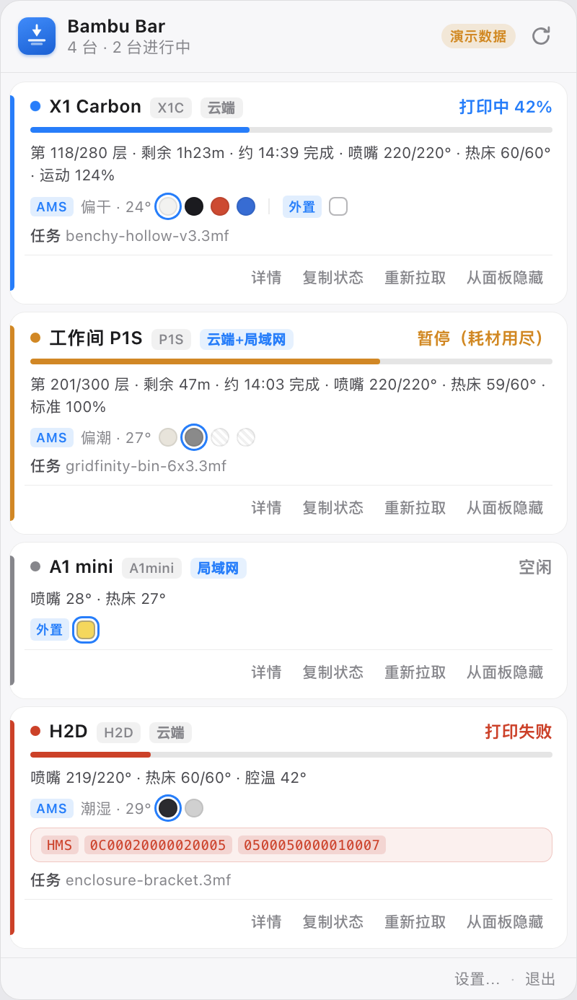
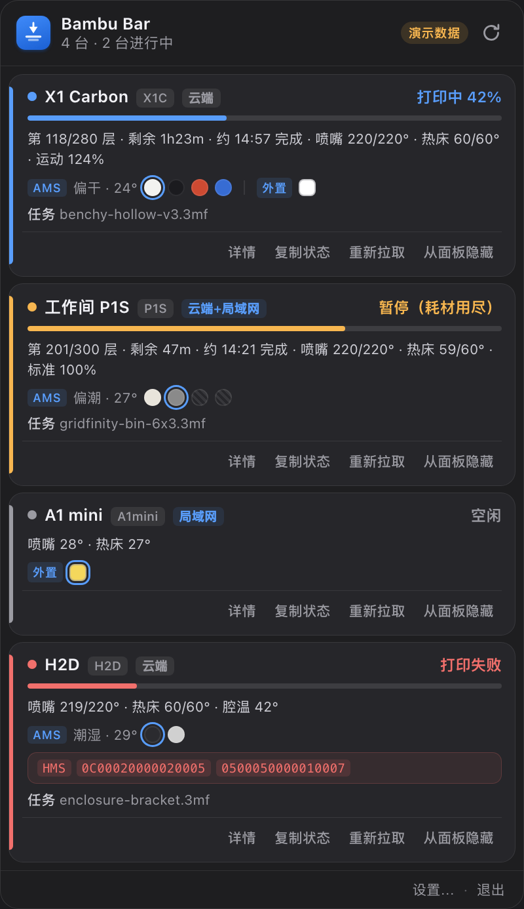
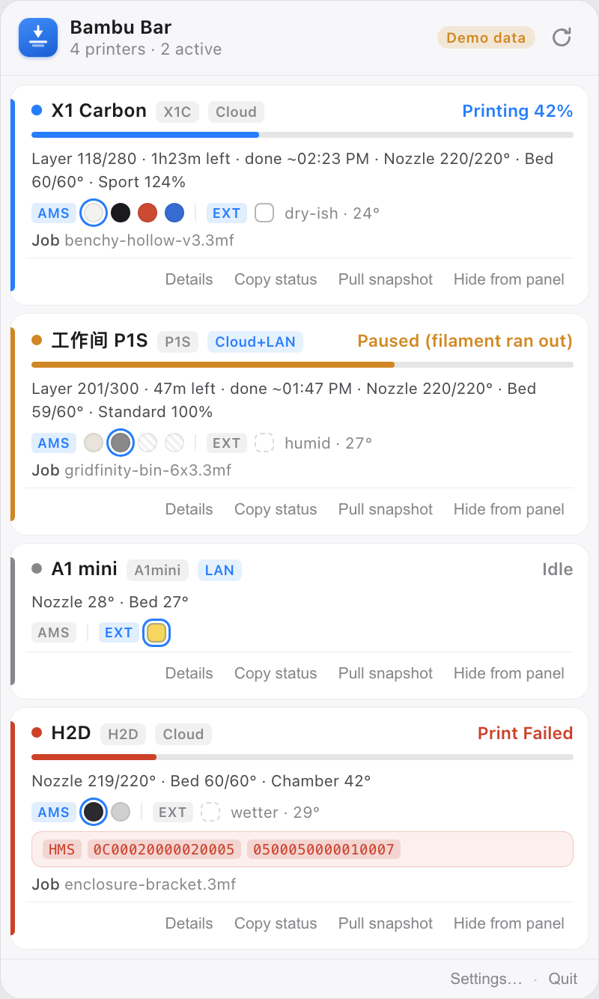
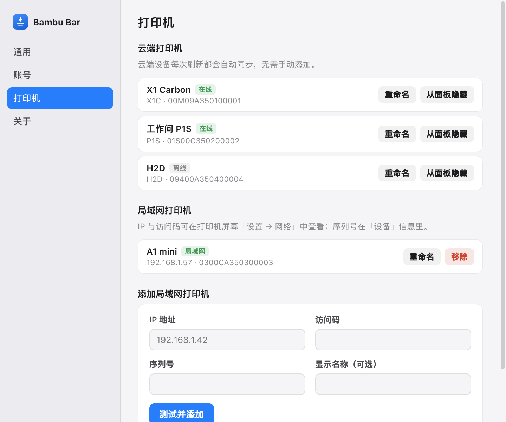
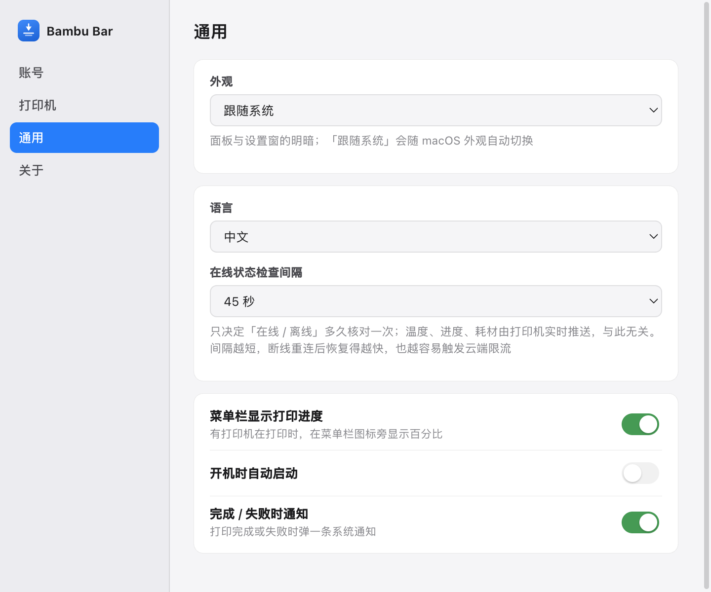

**[简体中文](#bambu-bar-菜单栏打印机监控) · [English](#bambu-bar--bambu-lab-printers-in-your-menu-bar)**

# Bambu Bar（菜单栏打印机监控）

一个 macOS 菜单栏应用：**点一下图标，列出所有已绑定的拓竹（Bambu Lab）打印机的实时打印状态。**

改造自 [YingyiDai/bambu-buddy](https://github.com/YingyiDai/bambu-buddy)（那只住在桌面上的熊猫）。上游把**打印机状态 → 桌面动画**；本项目复用它的连接与解析层，把**打印机状态 → 菜单栏面板**，并把上游已经解析出来、但熊猫用不上的字段全部摊开显示。

```
┌───────────────────────────────┐
│ 🖨 42%   ← 菜单栏图标 + 打印进度 │
└───────────────────────────────┘
```



<p align="center">
  
  
  
</p>

> 截图由 `npm run shot` 离屏渲染真实解析链路的输出，不是手绘示意图。

## 它显示什么

面板里每台打印机一张卡片，按你在账号下**所有已绑定**的设备自动出现（云端设备自动同步，不需要逐个添加）：

| 类别 | 字段 |
| --- | --- |
| 状态 | 打印中 / 准备中（含 78 种 `stg_cur` 阶段精确文案）/ 换料中 / 暂停（缺料、堵头、温控异常、首层异常、舱门…）/ 完成 / 失败（按官方 HMS 码表归到「断料 / 堵头 / 温度 / 机械 / 校准 / 打印板 / 喷嘴 / AMS」大类）/ 离线 / 登录失效 |
| 任务 | 文件名（`subtask_name` / `gcode_file`）、进度百分比、当前层 / 总层、剩余时间、**按本机时区算出的预计完成时刻**（跨自然日标 `+1`、`+2`） |
| 温度 | 喷嘴（当前 / 目标）、热床（当前 / 目标）；腔温**只在带腔温控制器的机型上显示**（H2C / H2D / H2D Pro / H2S / X1E / X2D），其余机型整行不显示 |
| 耗材 | 当前耗材颜色（双喷头按 `extruder.snow` 定位主喷头）、AMS 各槽颜色 + 材料 + 余量（悬停查看）、外挂料盘、AMS 湿度档与仓温 |
| 机器 | 速度档（静音 / 标准 / 运动 / 狂暴 + 倍率）、WiFi 信号、喷嘴直径与材质、风扇（模型 / 辅助 / 腔体）、腔灯、舱门 |
| 错误 | HMS 码（16 位十六进制，悬停显示官方文案）、`fail_reason` 与官方原因长句 |

细节（序列号、IP、风扇、腔灯…）点卡片底部常驻的「详情」按钮展开，展开后按钮变「收起」。

> **为什么腔温要按机型屏蔽**：没有腔温传感器的机型（A1 / P1S / X1 Carbon…）在报文里**仍然带**
> `chamber_temper`，但值固定是 `5` —— 我自己的 A1 / P1S / P1Sc 三台在喷嘴 21–24°C、
> 热床 21–22°C（即室温）时，全部报同一个 `5`。它不是测量值，是固件填的占位值，
> 直接显示就会给出一个假温度。所以腔温的可用性按机型判定，机型清单来自
> Bambu Studio 自己的机型配置 `support_chamber_temp_control`（切片器判断要不要显示腔温
> 用的就是它，本机 BambuStudio 02.08.02.61 实测：全局默认 0，只有上述 6 个机型重写为 1，
> **X1 Carbon 明确为 0**）。另外报文里若出现 `device.ctc.info.temp`（腔温控制器），
> 则无条件采信实测值 —— 这样新机型上市不必等这个清单更新。
> 实现见 `src/core/printer-view.js` 的 `resolveChamberTemp()`。

## 颜色

面板上的颜色**按状态取，不按机器取**：同一台机器状态一变，整张卡的颜色就跟着变；两台机器状态相同，颜色就一样。只有 6 个语义色，明暗两套（`src/popover/style.css:22-26` / `46-50`）：

| `statusClass` | 含义 | 浅色 | 深色 | 归入此类的 `stateKey` |
| --- | --- | --- | --- | --- |
| `printing` | 打印中 | `#0a7cff` | `#4c9dff` | `prepare`、`changing_filament`、`printing_*` 等所有进行中 |
| `paused` | 暂停 | `#d98300` | `#ffb340` | `paused` |
| `failed` | 失败 | `#d92d20` | `#ff6369` | `failed` |
| `finished` | 完成 | `#1f9d4d` | `#4ac26b` | `finished` |
| `online` | 空闲 | `#86868b` | `#9b9ba2` | `idle` |
| `offline` | 离线 | `#b4b4b9` | `#6a6a72` | `offline`、`authExpired` |

78 种 `stg_cur` 阶段由 `statusClassFromStateKey()`（`src/core/live-telemetry.js:16-27`）归并成上面 6 类。注意它的 `default` 分支：**凡认得出阶段、但不在那 5 个特例里的，一律算「打印中」**——所以「准备中」和「换料中」不单独配色。色相只有 6 个，用户才能一眼扫出异类。

选中的颜色写进 CSS 变量 `--st`，四个地方共用它：卡片左侧 3px 竖条（`.card::before`）、标题前的小圆点（`.dot`，打印中带脉冲动画）、右上角状态文字（`.card-status`）、进度条填充（`.progress > i`）。

**第二套颜色是耗材色，不是我们定义的**，来自打印机上报的 `tray_color`（`RRGGBBAA`）：

| 上报值 | 画成什么 |
| --- | --- |
| 有颜色 | 实心圆点，直接设 `--c` |
| `alpha = 00` | 斜纹灰点（`.slot.unknown`）—— 真机空槽报 `00000000`，若取前 6 位会被误当成黑料 |
| 当前出料槽 | 外加一圈蓝色双环（`.slot.active`） |
| 外挂料盘 | 方形虚线框（`.slot.ext`），与 AMS 槽区分 |

打印中进度条的填充色也会换成当前耗材色；但料太亮（`luma ≥ 0.82`，比如白料）时回退到状态蓝，否则白条在白底上看不见（`src/popover/popover.js:224-230`）。

> 一处已知的语义重叠：蓝色同时表示「打印中」和「局域网直连」（`.chip--lan` 也用 `--c-printing`）。
> 一台走局域网、但处于暂停状态的机器，会同时出现琥珀色竖条和蓝色 LAN 标签。目前认为可接受；
> 若觉得混淆，把 LAN 标签改成中性灰即可。

## 交互

- **左键点菜单栏图标** → 弹出面板（贴在图标正下方，点别处自动收起）
- **面板高度跟着打印机数量走**：一台就一小条，四台就四张卡；上限为托盘所在屏工作区的 86%，
  超过后卡片列表内部滚动，页脚（更新时间 / 设置 / 退出）始终可见
- **菜单栏文字**：有打印机在打印时显示平均进度 `42%`；有失败时显示 `!`（可在设置里关掉）
- **右键点图标** → 原生菜单：每台一行状态、立刻刷新、设置、**演示模式**、开机自启、退出
- **每张卡片底部常驻操作行**：详情、复制状态、重新拉取、从面板隐藏。
  它固定在卡片页脚（右对齐、上方一条 0.5px 分隔线），展开的详情块插在它上面
- 操作行**不做悬停显示**：面板高度由内容测量驱动，悬停一旦改变卡片高度，窗口就要跟着改尺寸，
  鼠标扫过卡片时会连续抖动。常驻既省一次交互，也让「卡片高度 = 窗口高度」这条链路不再受鼠标影响
- **打开面板时焦点不落在任何按钮上**：Chromium 的初始焦点会丢给第一个可聚焦元素（右上刷新按钮），
  那圈默认焦点环在 macOS 上跟随「系统强调色」，于是没人点过的按钮上会亮一圈框（强调色是橙色时就是橙框）。
  现在初始焦点收在面板容器上（`tabindex="-1"`，不画环），只有按 `Tab` 之后才用蓝色焦点环 ——
  键盘导航仍然有可见焦点
- **页脚不显示「更新于 x 秒前」**：那个相对计时每收到一帧报文就归零，而打印机空闲时约 5 秒一帧、
  打印中约 1 秒一帧，于是数字在 1~5 秒之间循环跳动，看起来像「面板每 5 秒刷新一次」。
  实际刷新节奏由打印机自己的上报频率决定，应用只在收到报文时重绘 —— 显示一个会跳的秒数没有信息量，只有误解
- **设置窗**四个分页：账号（登录）/ 打印机（重命名、移除、隐藏、加局域网机）/ 通用（外观明暗、语言、菜单栏进度、开机自启、系统通知、在线状态检查间隔）/ 关于（诊断信息）
- **外观**在「设置 → 通用」：跟随系统 / 浅色 / 深色，**切换即时生效**（只改 `nativeTheme.themeSource`，
  两个窗口都靠 CSS `prefers-color-scheme` 取色，所以不用重启）。面板右上只留刷新按钮 ——
  那里原来有个图标容易被读成「明暗切换」，设置入口统一走页脚「设置…」

> 没有打印机也能看效果：右键菜单勾上「演示模式（4 台示例打印机）」，应用会以演示数据重启，
> 面板顶部有「演示数据」角标。macOS 的 `open --args` 不保证把命令行参数送到应用进程，
> 所以这个开关存在偏好里，而不是只认 `--demo`。



## 连接方式

三种，与上游一致：

| 方式 | 说明 |
| --- | --- |
| 云端 · 浏览器登录 | 打开官方登录页，支持 Google / Apple / Facebook。**密码不经过本应用**：只监听会话 cookie 里的 token（绝不注入 JS、不读表单） |
| 云端 · 密码 / 短信验证码 | 中国大陆区（`api.bambulab.cn`）；海外区走浏览器登录 |
| 局域网直连 | 打印机 IP + 访问码 + 序列号，走局域网 MQTT（`bblp` + 自签名证书），不依赖外网 |

同一台打印机同时有云端与局域网配置时自动合并为「云端+局域网」，优先走局域网（低延迟、不上云）。

## 运行

```bash
npm install
npm start          # 启动（菜单栏出现图标）
npm run demo       # 没有打印机也能看效果（4 台演示机，走真实解析链路）
npm run build:mac  # 打包 + ad-hoc 签名 → dist/mac-arm64/Bambu Bar.app
npm test           # 纯逻辑单测（16 个用例）
npm run shot       # 离屏渲染面板/设置窗截图到 preview/
npm run xhs        # 生成小红书图文（8 张 1080×1440）到 xhs/
```

打包产物（`electron-builder`，仅 arm64，同时产出 `dir` 与 `dmg`）：

| 项 | 值 |
| --- | --- |
| 应用 | `dist/mac-arm64/Bambu Bar.app`（约 259 MB，Electron 38.8.6 全量） |
| 安装包 | `dist/Bambu Bar-1.0.0-arm64.dmg`（约 104 MB，APFS 格式） |
| Bundle ID | `com.bambubar.menubar`（`LSUIElement=true`，不占程序坞） |
| 签名 | ad-hoc，在 `afterPack` 阶段执行（`scripts/after-pack.js`） |
| 校验 | `codesign --verify --deep --strict` 通过；启动后 `--demo` 能解析出 4 台演示机 |

> **为什么要额外 ad-hoc 签一次**：没有 Developer ID 证书时 electron-builder 会跳过签名，
> 此时包内 Electron 只有 linker 阶段的 ad-hoc 签名（`Sealed Resources=none`），
> 与打包进去的资源不匹配，`codesign --verify` 会报 *code has no resources but signature
> indicates they must be present*，双击可能被判成「已损坏」。`scripts/after-pack.js`
> 在打包完成、生成 DMG 之前对整包重签并顺带清掉隔离属性 —— 所以 DMG 里打进去的
> 已经是签好的 app。**未做 Apple 公证**，分发给别人仍需 Developer ID + notarize。

若首次打开仍被 Gatekeeper 拦：右键 →「打开」，或 `xattr -dr com.apple.quarantine "dist/mac-arm64/Bambu Bar.app"`。

排障用的两个环境变量（都只打印、不改行为）：

```bash
BAMBU_BAR_DUMP=1 npm run demo          # 打印完整诊断（每台的状态/温度/层数/HMS）后退出
BAMBU_BAR_TRAY_DEBUG=hold npm start    # 打印托盘真实 bounds 与 setTitle 的值，不退出
```

`npm run shot` 另外认三个变量，用来出 README 里那几套截图与做断言：

```bash
PREVIEW_LOCALE=en npm run shot         # 英文（→ popover-en.png）
PREVIEW_DARK=1 npm run shot            # 暗色（→ popover-dark.png）
PREVIEW_CAP=360 npm run shot           # 把窗口压到 360px，断言列表内部滚动、页脚仍可见
PREVIEW_HOVER=1 npm run shot           # 断言「鼠标扫过卡片不改变面板高度」（delta 必须为 0）
```

> 在没有 GUI 权限的 shell 里跑截图会报 `sandbox initialization failed`，
> 加 `--no-sandbox` 即可：`npx electron --no-sandbox scripts/preview-shot.js`。

菜单栏应用没有窗口可看，启动阶段一旦抛异常，用户只会看到「双击了但什么都没发生」。
所以启动逻辑包了一层，错误会落到 `~/Library/Application Support/Bambu Bar/startup-error.log`
并弹一条系统通知；连接失败只会记录，不影响托盘与面板可用。

> 如果双击后毫无反应、菜单栏也没有图标：多半是上一次被强杀留下的 `SingletonLock`
> （指向一个已经死掉的 pid，应用会误以为「已有实例在运行」而静默退出）。删掉
> `~/Library/Application Support/Bambu Bar/Singleton*` 再启动即可。

## 数据与隐私

- 账号令牌、局域网访问码用系统钥匙串（Electron `safeStorage` / Keychain）加密后落盘；令牌只在主进程内使用，不下发给任何渲染进程。
- 连接只指向你自己的打印机：Bambu 云端（`api.bambulab.*` / `*.mqtt.bambulab.com`）或局域网 IP。没有第三方服务器。
- 官方 HMS 码表从 BambuStudio 仓库下载并缓存到本地数据目录，用于把错误码翻译成可读原因，失败则静默回退。

## 与上游的关系

`src/core/` 与 `src/config/locales.js`、`src/config/state-map.js` 直接取自 [bambu-buddy](https://github.com/YingyiDai/bambu-buddy)（MIT），未改动其协议与状态机逻辑：

| 模块 | 作用 |
| --- | --- |
| `bambu-auth.js` | 云端登录 / 双因子 / 短信验证码 / 设备列表 / uid |
| `bambu-mqtt.js` | 云 MQTT + 局域网 MQTT 数据源，增量报文深合并（AMS / 双喷头） |
| `printer-hub.js` | 多台连接生命周期（diff 式重连，云端轮询不闪断） |
| `state-machine.js` | 报文 → 状态文案（78 种阶段、取消/假完成/抖动兜底） |
| `completion-state.js` | 完成时刻记忆与「X 分钟前」 |
| `state-stabilizer.js` | 增量报文一帧级抖动的去抖 |
| `filament-color.js` | 当前耗材色（含双喷头 / 外挂料盘 / alpha=00 空槽） |
| `bambu-error-codes.js` | 官方 HMS 码表解析与失败归类 |
| `attention.js` / `printer-registry.js` | 多台聚合与排序 |
| `printer-view.js` | **本项目新增**：报文 → 面板视图模型（温度 / 进度 / AMS / 风扇…） |

未搬的部分是桌面宠物本身的渲染（透明窗、WebM 动画、换色遮罩、全屏隐藏、播放页、自动更新），它们服务于「一只熊猫住在桌面上」，与菜单栏面板无关。

## 已知限制

- **只读**：面板不做任何控制（暂停 / 停止 / 调温）。上游的协议层只发 `pushall` 请求，本项目不扩展控制指令。
- 没有摄像头画面（需 RTSP + 解码，上游也未做）。
- 仅 macOS 菜单栏形态；Windows 上能跑但没有托盘弹出面板的定位逻辑。
- 在线状态检查默认 45 秒（可改 30 / 90 秒）。打印中本体是 MQTT 实时推送，这一项**只**用于「设备是否在线」与设备列表同步，不控制温度 / 进度 / 耗材的更新，过短有被云端限流的风险。
- 中国大陆网络下访问 GitHub（更新检查、HMS 码表）可能需代理。

## 目录

```
src/
  main.js              托盘 / 弹出面板 / 设置窗 / IPC / 通知
  preload-*.js          两个窗口的最小能力桥
  popover/             面板渲染层（零框架）
  settings/            设置窗渲染层（零框架）
  core/                上游核心模块 + printer-view.js
  config/              状态映射、上游文案、本应用文案（中英）
  dev/demo-data.js     演示报文
scripts/
  gen-tray-icon.js     纯 Node 生成菜单栏模板图标（18pt / @2x）
  gen-app-icon.js      纯 Node 生成 .icns（与托盘同一套几何）
  after-pack.js        electron-builder afterPack 钩子：整包 ad-hoc 签名 + 清隔离属性
  sign-adhoc.js        独立签名脚本（也可手动执行）
  preview-shot.js      离屏渲染并截图
  gen-xhs.js           生成小红书图文（8 张 1080×1440）
assets/                托盘模板图、应用图标
test/                  纯逻辑单测
```

## 图标

菜单栏图标是**模板图**（macOS 只取 alpha 通道，随明暗自动反色），18pt / @2x 两张都由
`scripts/gen-tray-icon.js` 用纯 Node 栅格化（4× 超采样）生成，不依赖图形库。

形状自下而上读作「宽热床 → 窄喷嘴 → 宽加热块 → 细耗材丝」，逻辑坐标是 18×18 网格。
18pt 下的可读性全靠**粗细节奏**：喷嘴必须明显窄于加热块，否则两者会融成一个胶囊形，
整体读成「麦克风」；中间那层「正在打印的薄层」在 18px 下会糊成灰带，所以不放。

应用图标复用同一套几何（`scripts/gen-app-icon.js`），只是换成蓝底白图：圆角方块加
竖向渐变（`#3a96ff` → `#0a5ed8`），白色图形等比缩放到图标高度的 80% 并居中。

```bash
npm run icon   # 重出菜单栏模板图 + 应用 .icns（改几何后先看 scripts/tray-preview.png）
```

---

# Bambu Bar — Bambu Lab printers in your menu bar

A macOS menu bar app: **click the icon to see the live status of every Bambu Lab printer bound to your account.**

Built on top of [YingyiDai/bambu-buddy](https://github.com/YingyiDai/bambu-buddy) (the desktop panda). The upstream project turns *printer status → desktop animation*; this one reuses its connection and parsing layers and turns *printer status → a menu bar panel*, surfacing every field upstream already parses but the panda had no use for.


<p align="center">
  
  
  
</p>

**What each card shows:** status (printing / preparing with exact `stg_cur` stage / changing filament / paused with reason / finished / failed with official HMS category / offline / session expired), job name, percent, layer, remaining time, estimated finish time in your timezone (with `+1` day markers), nozzle / bed temperatures, current filament colour, every AMS slot plus the external spool and AMS humidity, speed profile, WiFi signal, nozzle spec, fans, chamber light, door, HMS codes and the official failure reason.

**Chamber temperature is model-gated.** Printers without a chamber sensor still report a `chamber_temper` field, but on an A1 / P1S / P1Sc it is a fixed `5` — all three of mine report the same value while their nozzles sit at 21–24 °C and beds at 21–22 °C, i.e. room temperature. It is a firmware placeholder, not a reading, so showing it produces a fake temperature. The capability list therefore comes from Bambu Studio's own machine profiles (`support_chamber_temp_control`; every model defaults to 0 and only H2C, H2D, H2D Pro, H2S, X1E and X2D override it to 1 — note X1 Carbon is 0). A `device.ctc.info.temp` field in the report wins over the list, so a newly released model works without waiting for an update. See `resolveChamberTemp()` in `src/core/printer-view.js`.

**Interaction:** left-click the menu bar icon for the panel (positioned under the icon, dismisses on blur); the menu bar title shows the average print percentage (or `!` when something failed); right-click for a native menu. Every card carries a permanent action row in its footer — details, copy status, pull snapshot, hide from panel — right-aligned above a hairline rule. The row never appears on hover: the panel height is content-measured, so a hover that changed card height would resize the window and make it jitter as the pointer sweeps across cards.

**Refresh cadence belongs to the printer, not the app.** The panel redraws when the printer pushes a report over MQTT — roughly once a second while printing, about every five seconds when idle — so no timer of its own drives the UI. The footer used to show "updated 2 s ago"; it reset on every incoming frame and therefore read as a five-second refresh cycle, which is why it is gone. The `Online-status check interval` setting only re-checks online / offline and syncs the device list — it does not control temperature, progress or filament.

**Colours** are keyed to *status*, not to the printer: a printer changes state and the whole card changes colour, while two printers in the same state share it. Six semantic colours, one set for light and one for dark (`src/popover/style.css:22-26` / `46-50`): printing `#0a7cff` / `#4c9dff`, paused `#d98300` / `#ffb340`, failed `#d92d20` / `#ff6369`, finished `#1f9d4d` / `#4ac26b`, idle `#86868b` / `#9b9ba2`, offline `#b4b4b9` / `#6a6a72`. `statusClassFromStateKey()` (`src/core/live-telemetry.js:16-27`) folds all 78 `stg_cur` stages into those six; its `default` branch means every recognised-but-unlisted stage counts as printing, so preparing and changing filament get no hue of their own — keeping the palette at six hues is what lets an outlier jump out while scanning. The chosen colour lands in the CSS variable `--st`, shared by four places: the 3px bar down the left of the card, the dot beside the title (pulsing while printing), the status text on the right, and the progress-bar fill.

Filament swatches are a second, independent colour source, reported by the printer as `tray_color` in `RRGGBBAA` rather than defined by the app. `alpha = 00` means "no colour" and renders as a hatched grey dot — real printers report `00000000` for an empty slot, so reading only the first six digits would show it as black filament. The currently extruding slot gets a blue double ring, an external spool is drawn as a dashed square, and while printing the progress bar takes the filament colour too, falling back to the status blue when the material is too bright to read against the track (`luma ≥ 0.82`, e.g. white).

**Appearance** lives in Settings → General (follow system / light / dark) and applies instantly without a restart: the setting only writes `nativeTheme.themeSource`, and both windows take their colours from CSS `prefers-color-scheme`. The panel header keeps a single refresh button — the icon that used to sit there read as a brightness toggle while actually opening settings, so the only settings entry is now the footer link.

**Connection:** cloud browser sign-in (Google / Apple / Facebook — the password never touches the app, only the session cookie's token is read), cloud password or SMS code for mainland China, or direct LAN MQTT via IP + access code + serial.

**Read-only by design:** no pause/stop/temperature control — the upstream protocol layer only publishes `pushall` requests, and this project does not add control commands. No camera stream either.

```bash
npm install && npm start      # run
npm run demo                  # 4 fake printers through the real parsing pipeline
npm run build:mac             # build + ad-hoc sign → dist/mac-arm64/Bambu Bar.app
npm test                      # 16 pure-logic tests
npm run shot                  # offscreen-render the screenshots in preview/
npm run xhs                   # render the 8 Xiaohongshu-sized images (1080×1440) into xhs/
```

**Build output:** arm64 only, both `dir` and `dmg` targets — `dist/mac-arm64/Bambu Bar.app`
(~259 MB) and `dist/Bambu Bar-1.0.0-arm64.dmg` (~104 MB, APFS). Bundle id `com.bambubar.menubar`
with `LSUIElement=true`. electron-builder skips signing without a Developer ID, leaving only the
linker-stage ad-hoc signature that mismatches the bundled resources — `scripts/after-pack.js`
re-signs the whole bundle in the `afterPack` hook, so the DMG already contains a signed app.
Verified with `codesign --verify --deep --strict`. Not notarized; redistributing needs a
Developer ID + notarization.

MIT. Upstream modules (`src/core/*`, `locales.js`, `state-map.js`) are © YingyiDai under MIT; `printer-view.js`, both renderer UIs and the tray layer are new.

**Icons.** The menu bar icon is a **template image** (macOS takes only its alpha channel and
inverts it with the menu bar), rasterised at 18pt and @2x by `scripts/gen-tray-icon.js` in plain
Node (4× supersampling), with no image library involved. Its shape reads bottom-up as
*wide heat bed → narrow nozzle → wide heater block → thin filament strand*, laid out on an 18×18
grid. At 18pt legibility rests entirely on that coarse-to-fine rhythm: the nozzle has to be
markedly narrower than the heater block, otherwise the two merge into a capsule and the whole
thing reads as a microphone; the thin "part being printed" layer in the middle would blur into a
grey band at 18px, so it is left out. The app icon reuses the same geometry
(`scripts/gen-app-icon.js`) on a rounded square with a vertical gradient (`#3a96ff` → `#0a5ed8`),
the white glyph scaled to 80% of the icon height and centred.
